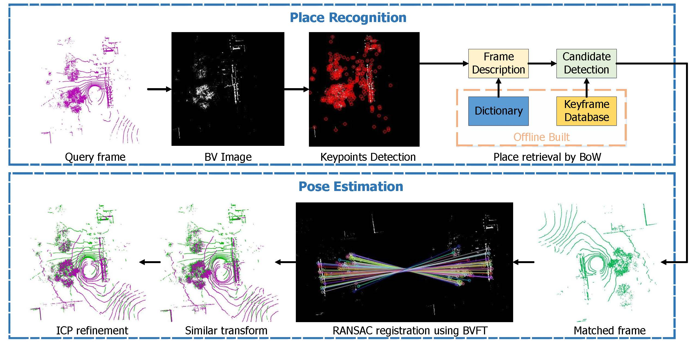
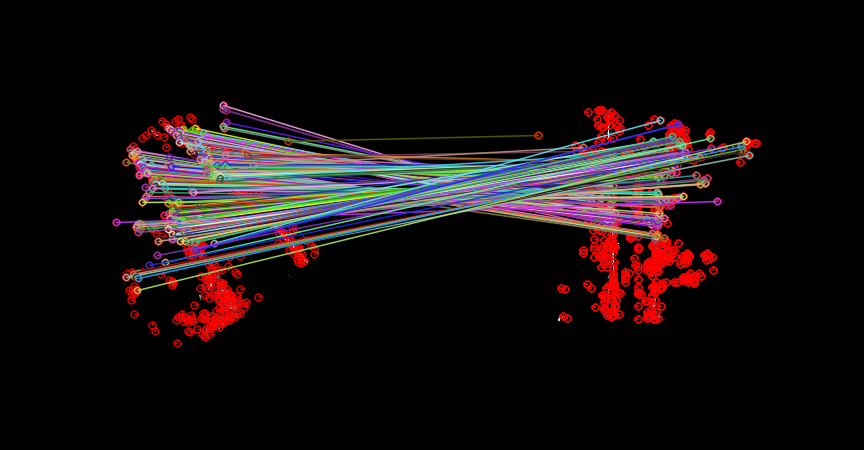

# BVMatch: Reconocimiento de Lugares Basado en LiDAR Usando Imágenes de Vista Superior (Bird's-Eye View)

BVMatch es un método de reconocimiento de lugares basado en LiDAR que es capaz de estimar poses relativas 2D. Proyecta los escaneos LiDAR en imágenes BV y extrae los descriptores BVFT de las mismas. El reconocimiento de lugares se logra mediante un enfoque de bolsa de palabras (bag-of-words), y la pose relativa se computa a través de la coincidencia de descriptores BVFT. 



## Dependencias

`OpenCV >= 3.3`

`Eigen`


## Ejemplo de uso
Solo ejecuta 

`mkdir build`

`cd build`

`cmake .. && make` 

`./match_two_scan ../data/xxx.bin ../data/xxx.bin`  

Verás el resultado de la coincidencia de dos escaneos LiDAR del conjunto de datos Oxford RobotCar,



## Evaluación del Reconocimiento de Lugares
#### 1. Descargar conjuntos de datos 
Descarga el conjunto de datos Oxford Robotcar [aquí](https://pan.zju.edu.cn/share/055cb9be0d6715fddd195f5e25) (unos 3,8 GB) o desde [Google Drive](https://drive.google.com/file/d/15M0FIHKeWvsMC1IgGpV_uVRrFnitT6t4/view?usp=sharing). Extrae la carpeta en el directorio del proyecto. Dirígete al directorio `scripts` y modifica el `root_path` en `config.py` para que apunte a la ruta del conjunto de datos.

Nota: Todas todas las siguientes operaciones se realizan dentro del directorio `scripts`.

#### 2. Generar descriptores locales
Extraemos con antelación los descriptores BVFT de cada submapa para el entrenamiento del modelo de bolsa de palabras y la generación de descriptores globales.

`python generate_local_descriptors.py`

Los descriptores locales se almacenan en la carpeta `local_des` dentro del directorio de la secuencia correspondiente.


#### 3. Entrenamiento del modelo de bolsa de palabras
Utilizamos las secuencias recopiladas en `2014` para el entrenamiento. (Puedes omitir este paso, ya que hemos incluido el modelo preentrenado en este repositorio)

`python train_model.py`


#### 4. Generar archivos pickle
Utilizamos las secuencias recopiladas en `2015` para las pruebas. Evaluamos el rendimiento del reconocimiento de lugares recuperando todos los submapas de cada secuencia a partir del resto de secuencias. La recuperación se considera exitosa cuando la distancia de verdad fundamental (ground truth) entre la consulta y la coincidencia es inferior a 25 metros. Las correspondencias de verdad fundamental se almacenan en los archivos pickle.

`python generate_test_sets.py`


#### 5. Evaluación
Genera los descriptores globales y realiza la evaluación. 

`python evaluate.py`

Nota: Este paso puede tardar varias horas, ya que se evalúan todos los submapas de las secuencias. 


## Cita
Por favor, cita este trabajo si deseas utilizarlo en tus proyectos:
```bibtex
@article{luo2021bvmatch,
  author={Luo, Lun and Cao, Si-Yuan and Han, Bin and Shen, Hui-Liang and Li, Junwei},
  journal={IEEE Robotics and Automation Letters}, 
  title={BVMatch: Lidar-Based Place Recognition Using Bird's-Eye View Images}, 
  year={2021},
  volume={6},
  number={3},
  pages={6076-6083},
  doi={10.1109/LRA.2021.3091386}
}
```


## Contacto
Lun Luo

Zhejiang University

luolun@zju.edu.cn
